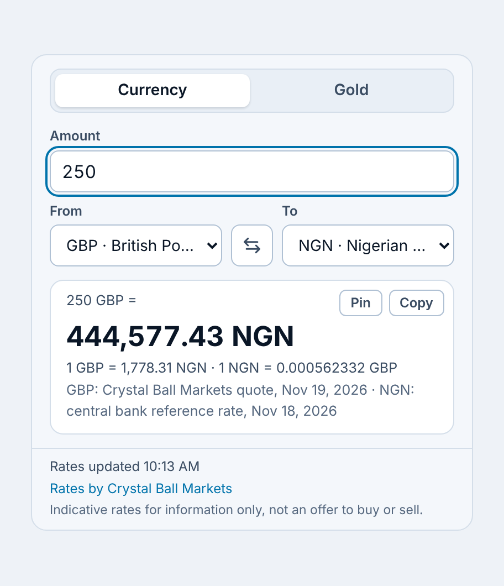

# crystal-ball-markets

A currency converter and gold value calculator for any web page, the sums behind it, and a client for the free [Crystal Ball Markets exchange rate and gold price API](https://crystalballmarkets.com/markets/rates-api): exchange rates for 60 currencies, the gold price in local money in 69 countries, and live quotes for forex, metals, energy, indices, shares and crypto. JSON, refreshed every minute, no sign-up.

```sh
npm install crystal-ball-markets
```

No dependencies. Works in browsers and in Node 18 or later, with TypeScript types.

## The converter

```html
<div id="converter"></div>
<script type="module">
  import { mountConverter } from 'crystal-ball-markets/converter';
  mountConverter('#converter');
</script>
```



Without a build step, import it from a CDN that serves npm packages:

```html
<script type="module">
  import { mountConverter } from 'https://cdn.jsdelivr.net/npm/crystal-ball-markets@2/converter.js';
  mountConverter('#converter');
</script>
```

One card with two tabs:

* **Currency.** An amount and two currencies. The result appears as the visitor types, with the rate in both directions, where each rate comes from and its time. Swap the pair, copy the result, pin up to four pairs.
* **Gold.** A weight in grams, troy ounces, tolas, pavans, baht, taels or kilograms, a purity from 24K to 14K and a currency. It shows what the gold in that weight is worth at the international price, and the price of one gram at 24K, 22K and 18K.

It brings its own look, in light or dark, and keeps it inside any page's styles. Every sum is done in the page. Nothing the visitor types is sent anywhere; a pair they pin is kept in their own browser.

```js
mountConverter('#converter', {
  show: 'both',          // or 'currency' or 'gold' for one alone
  tab: 'currency',       // the tab it opens on
  amount: 100, from: 'GBP', to: 'NGN',
  weight: 10, unit: 'tola', purity: '22k', goldCurrency: 'INR',
  theme: 'light',        // or 'dark', or 'auto' for the visitor's own setting
  lang: 'en',            // numbers, dates and currency names; defaults to the page's language
  labels: { amount: 'Montant' },   // any of LABELS in your own words
});
```

It returns `{ element, ready, refresh(), destroy() }`.

**On your own machine it shows sample rates.** The API serves public sites, so on `localhost`, a `.test` or `.local` address or a file, the converter shows the rates packed with the package, marked as a sample with their date, and asks the API for nothing. Current rates load on your public site.

**The link.** The API's terms ask every page that shows its figures to carry a visible link, “Rates by Crystal Ball Markets”. The converter shows it under the figures, so a page that uses it meets the terms as it is. Pass `credit: false` only when the same page already shows the link elsewhere.

**Rates read on your server.** Pass them in, and the converter asks the API for nothing:

```js
mountConverter('#converter', { data: ratesFromYourServer });   // { rates, gold, at } from client.getData()
```

**A strict content security policy.** The converter adds one `<style>` element. To serve the stylesheet yourself, pass `styles: false` and write out `CONVERTER_CSS` (exported from `crystal-ball-markets/converter`) once at build time.

## The sums

For when the rates are already on hand. No network, no dependencies.

```js
import { convert, goldValue, parseAmount, UNITS, PURITIES, unitOf, purityOf } from 'crystal-ball-markets';

convert(100, 'GBP', 'NGN', rates);            // 100 pounds in naira, or null when a rate is missing
goldValue(10, unitOf('tola').grams, purityOf('22k').fine, usdPerOunce, rates.INR.rate);   // ten tolas of 22K gold in rupees
parseAmount('1.234,56');                      // 1234.56: reads the ways people write numbers
```

`rates` is the `data.rates` of `rates.json`: units of each currency for one US dollar. `crystal-ball-markets/sample` exports a dated `SAMPLE` of them for tests and demos.

## The client

In a web page the browser names your site, so no options are needed:

```js
import { createClient, ATTRIBUTION_HTML } from 'crystal-ball-markets';

const cbm = createClient();
const eur = await cbm.getRate('EUR');                 // euros per 1 US dollar
const ngn = await cbm.convert(100, 'GBP', 'NGN');     // 100 pounds in naira
const gold = await cbm.getGoldPrice('IN');            // gold price in India, in rupees
const chain = await cbm.goldValue({ weight: 8, unit: 'gram', purity: '22k', currency: 'INR' });
document.querySelector('#credit').innerHTML = ATTRIBUTION_HTML;
```

On a server, in an app or a script, name the page of your own site that shows the figures and send a secret of your own (16+ characters). The first call reserves that site for your key.

```js
const cbm = createClient({
  site: 'https://your-site.com/rates',
  key: process.env.CBM_SITE_KEY,
});
console.log(await cbm.getQuote('XAUUSD'));
```

| Method | Returns |
| --- | --- |
| `getRates()` | the full `rates.json` file |
| `getGold()` | the full `gold.json` file |
| `getQuotes()` | the full `quotes.json` file |
| `getRate(code)` | units of `code` per 1 USD |
| `convert(amount, from, to)` | `amount` converted through USD |
| `goldValue({ weight, unit, purity, currency })` | what a weight of gold is worth |
| `getGoldPrice(country)` | the gold entry for an ISO country code |
| `getQuote(ticker)` | one market's quote, e.g. `EURUSD` |
| `getData()` | `{ rates, gold, at }` for the sums and the converter |

Responses are cached for at least 60 seconds, as the terms ask.

## Terms in short

Show this link, visible and unchanged, wherever the figures appear (no `nofollow`, `ugc` or `sponsored`):

```html
<a href="https://crystalballmarkets.com/markets">Rates by Crystal Ball Markets</a>
```

The site you name must be on a domain of your own. Up to 60 requests a minute per address. Figures are indicative and for information only: they are not dealing prices and not an offer to buy or sell. Full terms: <https://crystalballmarkets.com/markets/rates-api>.

## From version 1

Nothing was removed. Version 2 adds the converter, the sums, `goldValue()` and `getData()`. `getRate('USD')` now answers 1.

MIT licence. Questions: support@crystalballmarkets.com.
